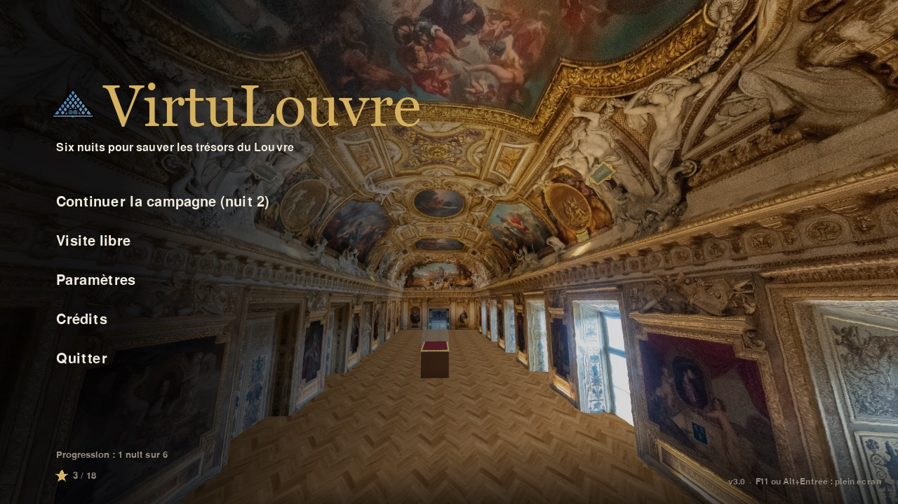
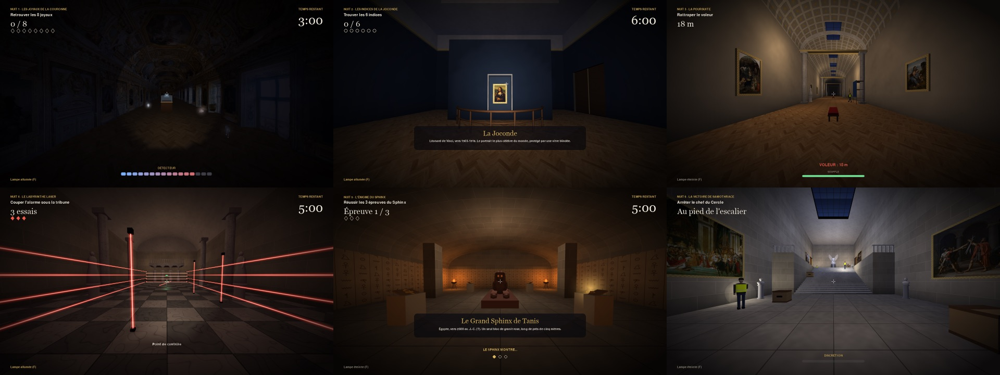
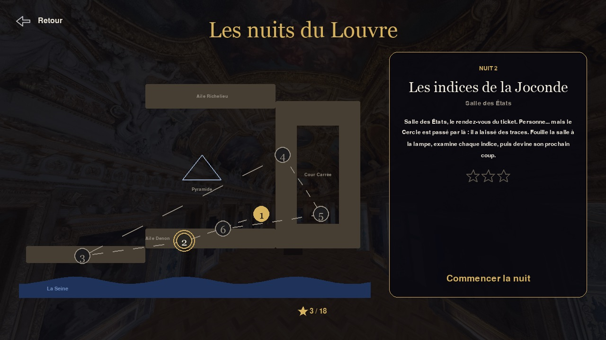

# VirtuLouvre

**English** · [Français](README.fr.md)

**Six nights to save the treasures of the Louvre.** VirtuLouvre is a 3D video game written in Python (pygame-ce, OpenGL, NumPy) that runs on **Windows, macOS and Linux**. You play a campaign of six missions in six rooms of the museum: the Galerie d'Apollon, rebuilt from a 3D scan, and five rooms modeled entirely in code. The paintings on the walls are the real ones, public-domain reproductions. The game is in French.



## The campaign: nights at the Louvre

On 19 October 2025, eight of the French Crown Jewels were stolen from the Galerie d'Apollon. The game takes this event as a starting point to invent a story: a gang of thieves, the Circle (*le Cercle*), strikes the museum night after night. Each night takes place in a different room, with its own mechanic.

| Night | Room | Mission | What you do |
| --- | --- | --- | --- |
| 1 | Galerie d'Apollon | The Crown Jewels | Search the gallery in the dark, with a flashlight and a detector, to find the 8 jewels |
| 2 | Salle des États | The Mona Lisa clues | Examine 6 clues around the Mona Lisa, then work out the Circle's next move |
| 3 | Grande Galerie | The chase | Catch a fake restorer running off with *La Belle Ferronnière*, while managing your stamina |
| 4 | Salle des Cariatides | The laser maze | Get through fixed, sweeping, rotating and blinking beams (jump, crouch) |
| 5 | Crypt of the Sphinx | The Sphinx's riddle | Repeat the Sphinx's hieroglyph sequences to open its hiding place |
| 6 | Daru staircase | The Winged Victory of Samothrace | Sneak past the lookouts and their lamps, then arrest the Circle's leader |



Each night you complete unlocks the next one on the museum map, and earns 1 to 3 stars depending on your time, mistakes or stealth. Progress and records are saved.



## Free tour

All six rooms can also be explored freely, lights on and full of people: visitors walk from one artwork to the next (some take photos, others look at their phones), a crowd gathers in front of the Mona Lisa, a guide shows the paintings to her group, and a guard keeps watch from his chair. You can fly up to the ceilings and get close to the artworks: when you look at a painting or a statue, its label appears (title, artist, date).

## Characters and sound

All the characters are modeled and animated in code: guards, police officers, thieves, hooded lookouts, the Circle's leader, a curator, a guide, and randomly generated visitors (face, skin, hairstyle, beard, glasses, cap, beret, backpack, audio guide, skirt, short sleeves...). Their skeleton has knees, elbows and a head that turns: they walk, run, raise their hands, cross their arms, sit down, point at a painting and follow you with their eyes as you walk by.

No audio files: everything is synthesized at startup, in the background. Each night has its own music (piano for the menu, pizzicato for the investigation, drums for the chase, electronic arpeggios for the lasers, an oriental harp for the Sphinx, a muffled pulse for the infiltration), ambiences (rain on the glass roof, wind and braziers in the crypt, the murmur of the crowd), footsteps that change with the floor (parquet, marble, stone), and sound effects: the detector's sonar, the jingle of the jewels, a whistle, the alarm bell, handcuffs, the lookouts' walkie-talkies, a heartbeat when you are about to be spotted, the voice of the Sphinx...

## Running the game

You need **Python 3.9 or later** ([python.org](https://www.python.org/downloads/)). The first launch installs the dependencies in a `.venv` folder, which takes about a minute; later launches start right away.

| System | How to launch |
| --- | --- |
| Windows | Double-click `lancer.bat` (when installing Python, check "Add python.exe to PATH") |
| macOS | Double-click `lancer.command`. The first time, if macOS blocks it: right-click, then "Open" |
| Linux | `./lancer.command` in a terminal (on Debian/Ubuntu you need the `python3-venv` package) |

### Manual installation

```bash
python3 -m venv .venv                                 # Windows: py -m venv .venv
.venv/bin/python -m pip install -r requirements.txt   # Windows: .venv\Scripts\python ...
.venv/bin/python main.py
```

### Troubleshooting

- **`pygame` and `pygame-ce` installed together**: both install into the same `pygame` folder and conflict. Run `pip uninstall pygame pygame-ce`, then `pip install -r requirements.txt`. The game warns you about this at startup.
- **Graphics card**: OpenGL 2.0 is required (every card since 2004). Without a graphics driver (a virtual machine without 3D, "Microsoft Basic Display Adapter"), the game shows a message instead of starting. On Linux, you need the Mesa drivers (`sudo apt install libgl1` on Debian/Ubuntu).
- **No sound**: the game keeps running silently if the computer has no audio output.

## Controls

| Key | Action |
| --- | --- |
| Z Q S D, W A S D or arrow keys | Move (both AZERTY and QWERTY work) |
| Mouse | Look around |
| Shift | Run (watch your stamina during the chase) |
| Space | Jump / fly up |
| C | Crouch (stealthier, gets under the lasers) / fly down |
| E | Examine, interact (clues, symbols, alarm, arrest...) |
| F | Turn the flashlight on / off |
| G | Fly / land (free tour) |
| Esc | Pause / back |
| F11 or Alt+Enter | Fullscreen (on a Mac, F11 controls the volume: use Option+Enter) |
| F12 | Screenshot (`captures/` folder) |

Every key (except Esc, F11, F12 and the arrow keys) can be remapped in **Paramètres > Touches** (Settings > Keys). Settings and progress are saved in `config/settings.json`. To restart the campaign from the beginning: **Paramètres > Partie > Réinitialiser la progression** (Settings > Game > Reset progress).

## Project structure

```
VirtuLouvre/
├── main.py              # Entry point (and self-test: python main.py --test)
├── jeu/                 # The game
│   ├── app.py           # Main loop, rendering, screens (menu, map, briefing, pause, ending...)
│   ├── missions.py      # The six nights of the campaign
│   ├── salles.py        # The six rooms: geometry, collisions, lights, artworks
│   ├── modeles.py       # 3D models built in code: characters, statues, jewels, furniture
│   ├── acteurs.py       # The player, the characters (patrols, vision, skeleton, poses) and the crowd
│   ├── rendu.py         # OpenGL: procedural textures, meshes, lighting, effects
│   ├── interface.py     # 2D interface (buttons, text, sliders)
│   ├── sons.py          # Sounds, music and ambiences synthesized with NumPy
│   └── base.py          # Constants, settings, small math helpers
├── src/
│   ├── models/          # 3D scan of the Galerie d'Apollon (.obj)
│   ├── tableaux/        # Reproductions of public-domain artworks (see CREDITS.txt)
│   ├── textures/        # Scan texture, parquet, sky
│   ├── media/           # Video of the first prototypes
│   └── icons/           # Interface icons
├── config/              # Player settings and progress
├── docs/                # Previews for this README
├── lancer.bat           # Windows launcher
├── lancer.command       # macOS / Linux launcher
├── dependances/         # Old installers (Windows .exe, shell script)
└── Tests/               # The team's prototypes
```

## Technical documentation

- **Rooms (`salles.py`)**: a builder assembles floors, walls with doorways, barrel vaults, fluted columns, staircases and framed paintings. Every surface is split into small tiles, because "classic" OpenGL lighting is computed per vertex and a large face would stay uniform. At the same time, it fills three top-down maps: impassable cells, floor height (for staircases) and the height of obstacles that block the view (to know whether a lookout can see the player behind a crate). The Galerie d'Apollon comes from a 3D scan; its collision map is computed from the scan's geometry at body height.
- **Models (`modeles.py`)**: everything is built from simple shapes (boxes, surfaces of revolution, tori, tubes along a curve, cut stones, prisms). Characters have ten parts (torso, head, thighs, legs, upper arms, forearms) and an outfit drawn from a seed: a given visitor always looks the same. Skin and clothing colors are "rgb:r,g,b" materials created on the fly.
- **Textures (`rendu.py`)**: marble, ashlar stone, floor tiles, coffered ceilings, hieroglyphs... are computed at startup with NumPy. They use periodic noise (a sum of sine waves with integer frequencies), so the texture repeats without a visible seam.
- **Characters (`acteurs.py`)**: a simple skeleton (pelvis, hips, knees, shoulders, elbows, neck) whose angles come from walking, running and poses. The same chain of transformations is used to draw (OpenGL) and to compute where a lookout's lamp points (NumPy). Patrols with pauses, field of view (range, angle, obstacles), reaction to the sound of running. Visitors pick a nearby artwork they can reach in a straight line, look at it for a while, then move on; you can't walk through them.
- **Missions (`missions.py`)**: each mission sets up the room, advances its logic every frame, offers interactions (E key) and draws its part of the interface. The lasers use the distance between two segments (the beam and the player's body).
- **Sound (`sons.py`)**: a small synthesis toolkit. Additive synthesis (bells, glass, marimba, piano with slightly detuned partials, brass whose high harmonics rise with the breath), Karplus-Strong plucked strings (harp, pizzicato), formant voices (crowd murmur, walkie-talkie, Sphinx), noise filtered in the Fourier domain (footsteps, rain, scraping stone), convolution reverb with a stereo room response. Music and ambiences loop without clicks: notes that run past the end wrap around to the beginning, and the echo is a circular convolution. Everything is computed in a separate thread while you are on the menu.

The self-test (`python main.py --test`, no window) checks the settings, the models and the rooms. It also checks that every jewel can be reached, that the staircase can be climbed, that a bot managing its stamina can catch the night-3 thief, that visitors don't walk through walls, that the lookouts' lamps light up what's in front of them, and that every sound is generated without errors.

## Credits

Developed by **Albert Oscar**, **Moors Michel** and **Rinckenbach Yann** for the Trophées NSI (a French national high-school computer science competition).

- Galerie d'Apollon: 3D scan of the gallery.
- Rooms, characters, statues and jewels: modeled in code. They are loose interpretations of the real rooms, and the jewels are interpretations of the originals.
- Paintings: public-domain reproductions, via Wikimedia Commons (full list in `src/tableaux/CREDITS.txt`).
- Sky texture: Freepik.

The story of the Circle, its six nights and its characters are fictional.

## License

This project is licensed under the GPL v3+. See the `licence.txt` file.
